  

  <picture>
    <source media="(prefers-color-scheme: dark)" srcset="./assets/readme/tagline-dark.svg" />
    
  </picture>

  <b>OASIS Route is the first-party, open-source inference-routing companion to OASIS.</b> 
  It is a self-hosted LLM gateway and free-tier router: verified provider access, quota-aware model selection, 
  and honest failover behind one OpenAI- and Anthropic-compatible endpoint and one key.

  OASIS owns the agent runtime, tools, and orchestration. OASIS Route handles authorized upstream
  connections, eligibility and spend policy, quota-aware inference routing, and failover. Route is
  deployed separately and remains usable by any OpenAI- or Anthropic-compatible client.

  
  
  
  
   
  
  
  
  
   
  
  
  
   
  
  
  
  

> [!NOTE]
> **OASIS Route 0.2.0 is out: the unified gateway release.** About 220 providers and 2,000 models in an advertised catalogue (never shown as verified until checked), `oasis-route setup` onboarding, nine explainable routing strategies, spend modes that ask before paying, a USD budget ledger with receipts, paste-ready settings for Claude Code, Codex, Cursor and more, and a new operator CLI. Nothing paid is ever enabled or used silently.
> [Read the announcement](docs/releases/v0.2.0.md) · [GitHub release](https://github.com/FAHTHIZ/OASIS-ROUTE/releases/tag/v0.2.0) · [Changelog](CHANGELOG.md#020---2026-11-25)

  <a href="#quickstart"><b>Quickstart</b></a> &nbsp;·&nbsp;
  <a href="#how-many-free-tokens"><b>How many free tokens? (~1.7B/mo)</b></a> &nbsp;·&nbsp;
  <a href="#why-oasis-route">Why</a> &nbsp;·&nbsp;
  <a href="#discover-free-capacity">Discover</a> &nbsp;·&nbsp;
  <a href="#how-it-works">How it works</a> &nbsp;·&nbsp;
  <a href="#api-compatibility">API</a> &nbsp;·&nbsp;
  <a href="#how-it-compares">Compare</a> &nbsp;·&nbsp;
  <a href="#documentation">Docs</a>

  <picture>
    <source media="(prefers-color-scheme: dark)" srcset="./assets/readme/stats-dark.svg" />
    
  </picture>

<b>Table of contents</b>

 

- [Quickstart](#quickstart)
- [Use with OASIS](#use-with-oasis)
- [How many free tokens?](#how-many-free-tokens)
- [Why OASIS Route](#why-oasis-route)
- [Discover free capacity](#discover-free-capacity)
- [How it works](#how-it-works) · [The Oasis Key](#the-oasis-key) · [Capabilities](#capabilities)
- [API compatibility](#api-compatibility) · [Providers and free tiers](#providers-and-free-tiers)
- [How it compares](#how-it-compares)
- [Implementation status](#implementation-status) · [Known limitations](#known-limitations)
- [Security and trust](#security-and-trust)
- [Documentation](#documentation) · [Design principles](#design-principles)
- [Contributing](#contributing) · [License](#license)

<picture><source media="(prefers-color-scheme: dark)" srcset="./assets/readme/divider-dark.svg"></picture>

## Quickstart

  <picture>
    <source media="(prefers-color-scheme: dark)" srcset="./assets/readme/quickstart-dark.svg" />
    
  </picture>

### 1. Run locally — no upstream account required

The fastest way to explore OASIS Route is its deterministic mock-provider mode. It starts the application without making upstream inference calls.

Requires [uv](https://docs.astral.sh/uv/).

~~~bash
uvx --from git+https://github.com/FAHTHIZ/OASIS-ROUTE oasis-route dev --open
~~~

The command opens the console already signed in on **Get started**, connects any local model server it finds (Ollama, LM Studio, vLLM, ...), and lists where to get free keys. Paste them in the console, or run `oasis-route connect` in a second shell and paste them there. Until something real is connected, `model=auto` answers with a built-in demo echo, and the console says so.

### 2. Run with Docker

No local Python installation is needed:

~~~bash
docker run --rm -p 8080:8080 ghcr.io/fahthiz/oasis-route:edge dev
~~~

### 3. Install the command

~~~bash
uv tool install git+https://github.com/FAHTHIZ/OASIS-ROUTE
# Or: pipx install git+https://github.com/FAHTHIZ/OASIS-ROUTE

oasis-route dev --port 8080
~~~

### 4. Develop from a clone

~~~bash
git clone https://github.com/FAHTHIZ/OASIS-ROUTE.git
cd OASIS-ROUTE
uv sync
uv run oasis-route dev
~~~

### 5. Connect a provider and make a request

Open <code>/console/</code> and sign in with the Oasis Key. On **Connections → Paste your keys**, paste every provider key you hold (or your whole `.env`), tick the ownership box and press **Connect all**. Each key's provider is recognised automatically, the key is checked only with that provider, its models (and which of them are free) are synchronised, and routing starts using them immediately. **Discover** lists every provider with verified free capacity and links straight to where each one issues its free key; OpenRouter and Hugging Face can also be connected with **Sign in with ...** instead of a key.

The same step from a terminal, reading `GROQ_API_KEY`, `GEMINI_API_KEY`, `OPENROUTER_API_KEY`, `NVIDIA_API_KEY`, `HF_TOKEN` and the others from your environment or a `.env` file:

~~~bash
oasis-route connect --from-env                 # preview: shows what was recognised, stores nothing
oasis-route connect --from-env --env-file .env --accept-terms --free-tier
~~~

`oasis-route setup` does the rest in one go: it finds Ollama, llama.cpp, vLLM, LM Studio and other local servers on their default ports, connects them as last-resort free routes, lists the verified free providers you can still connect, classifies every route as free, paid or unknown and eligible, blocked or exhausted, and prints the single endpoint to use. It never enables a paid route. See [docs/ONBOARDING.md](docs/ONBOARDING.md).

Or let the local all-in-one pick them up every time it starts (keys already connected are skipped, and the built-in mock providers are paused once a real provider is active):

~~~bash
GROQ_API_KEY=gsk_... GEMINI_API_KEY=AIza... oasis-route dev --connect-env --free-tier --age 25 --country BD
~~~

`--age` and `--country` are your own declaration, needed by providers whose terms set an age or country rule. Hugging Face can also be connected on a headless server by **Hugging Face with a code**: enter the short code shown on any device where you are signed in.

Then call the gateway:

~~~bash
curl https://route.example.com/v1/chat/completions \
  -H "Authorization: Bearer $OASIS_API_KEY" \
  -H "content-type: application/json" \
  -d '{
    "model": "auto",
    "messages": [
      {"role": "user", "content": "Explain the difference between a process and a thread."}
    ]
  }'
~~~

`model: "auto"` picks the strongest eligible model across all your connections (free first) and moves to the next strongest when one runs out of quota or fails. Claude Code and other Anthropic clients work through the Anthropic Messages endpoint:

~~~bash
export ANTHROPIC_BASE_URL=https://route.example.com
export ANTHROPIC_AUTH_TOKEN=$OASIS_API_KEY
claude
~~~

Any OpenAI SDK can use the same gateway by setting its base URL to <code>https://route.example.com/v1</code> and its API key to the Oasis Key.

Every coding tool gets its settings printed for you (`oasis-route integrate claude_code`, `codex`, `cursor`, `cline`, `roo_code`, `aider`, `opencode`, `continue`), and `oasis-route doctor`, `quota`, `preview` and `explain <request-id>` show what the gateway is doing and why ([docs/CLI.md](docs/CLI.md)).

### Production deployment

For a PostgreSQL-backed deployment, follow the [deployment guide](docs/DEPLOYMENT.md):

~~~bash
# Create .env with:
# POSTGRES_PASSWORD
# OASIS_ROUTE_MASTER_KEY
# OASIS_ROUTE_API_KEY_PEPPER

docker compose up -d --build
docker compose run --rm api bootstrap --email you@example.com
~~~

## Use with OASIS

OASIS Route is the first-party inference-routing companion for the OASIS agent runtime. OASIS remains responsible for agent execution, tools, and orchestration; Route manages upstream provider connections, eligibility, quota reservations, model selection, and inference failover.

OASIS `main` now includes a built-in `oasis-route` provider and a dedicated **OASIS Route** setup choice; the integration is pending the next OASIS release. Released builds can use the generic OpenAI-compatible endpoint in the meantime. For local development, run Route on port `8081` to avoid colliding with llama.cpp's common port `8080`; the exact key and connection steps are in the [OASIS integration guide](docs/OASIS_INTEGRATION.md).

See [OASIS integration](docs/OASIS_INTEGRATION.md) for the exact local setup, current limitations, and the intended boundary. OASIS does not depend on Route: it can continue using direct providers or other gateways, and Route remains useful to other compatible clients.

## How many free tokens?

  <picture>
    <source media="(prefers-color-scheme: dark)" srcset="./assets/readme/total-dark.svg" />
    
  </picture>

### The total

If you sign up **once** at every free LLM tier anyone lists (official providers plus the gateways FreeLLMAPI and OmniRoute track) and count every shared pool only once, you get:

| Layer | Chat (1,500 tokens a request) | Coding agent (20,000 tokens a request) |
|---|---|---|
| Verified official limits, nothing bought | ~32M | ~71M |
| Every first-party free tier (labs and inference clouds) | ~256M | ~418M |
| **Everything listed, one account each, recurring** | **~626M** | **~1.7B** |
| + OpenRouter's one-time 10-credit unlock | ~669M | ~2.3B |
| + rate-limit-only tiers (NVIDIA, SEA-LION, OVH…) run 24/7 | ~4.4B (ceiling) | ~52.5B (ceiling) |

**Bottom line: about 1.7 billion free tokens a month in total, of which about 70 million are on official, verified limits.** [FreeLLMAPI](https://github.com/tashfeenahmed/freellmapi) advertises 10.1B because it adds each model's own budget label even when the provider shares one pool across all of them (26 Cloudflare models × ~15M against a single 10,000-neuron daily budget, for example). Run its own public catalog through the same method and it sums to 1.47B. Most of [OmniRoute's 1.62B](https://github.com/cheaper-inference/OmniRoute/blob/main/docs/reference/FREE_TIERS.md) is Mistral, which has no free API access. Every number on the card comes from `python scripts/ecosystem_capacity.py`, and the per-pool table is in [the whole-ecosystem section](docs/FREE_TIER_CAPACITY.md#the-whole-ecosystem).

### What OASIS Route routes today

  <picture>
    <source media="(prefers-color-scheme: dark)" srcset="./assets/readme/capacity-dark.svg" />
    
  </picture>

Counted from each provider's **published** limits on 2026-11-23, one account per provider, with the binding limit (tokens a day, requests a day, tokens a minute, monthly caps or neuron budgets) applied per request size:

| You have… | Chat (1,500 tokens a request) | Coding agent (20,000 tokens a request) |
|---|---|---|
| **Free accounts only, nothing bought** | **~24M-32M tokens / month** | **~63M-71M tokens / month** |
| + one-time 10-credit OpenRouter top-up | ~75M | **~650M** |
| + NVIDIA prototyping API at 100% use | ~2.7B (ceiling) | ~36B (ceiling) |

**Bottom line: about 30 million tokens a month for chat and about 70 million for agents, with no purchase.** Groq contributes the most chat capacity (200K tokens a day on each of three models); OpenRouter's shared `:free` pool and Cohere's 1,000 monthly trial calls favour large agent requests. Gemini and Z.ai's free GLM Flash models add more, but publish no numbers, so they are measured after you connect them instead of guessed. Every figure is reproducible with `python scripts/free_tier_capacity.py`; the method, per-pool table and change log are in [Free-tier capacity maths](docs/FREE_TIER_CAPACITY.md).

> [!NOTE]
> OmniRoute advertises about 1.62B free tokens a month. By its own breakdown, about 1B of that is Mistral, whose usage-limits page now says Free mode doesn't include API access, and about 545M comes from third-party aggregators and proxies. Its first-party pools add up to about 68M, in line with the range above. See the [comparison](docs/FREE_TIER_CAPACITY.md#comparison-with-other-gateways-claims).

## Why OASIS Route

<table>
  <tr>
    <td width="33%" valign="top">
      <picture><source media="(prefers-color-scheme: dark)" srcset="./assets/readme/icon-discover-dark.svg"></picture>
      <h3>Evidence-backed discovery</h3>
      Official pages, catalogues and feeds are checked on a schedule. Every offer keeps its source, date and review trail, and nothing is routed until it is verified.
    </td>
    <td width="33%" valign="top">
      <picture><source media="(prefers-color-scheme: dark)" srcset="./assets/readme/icon-route-dark.svg"></picture>
      <h3>Strongest model first</h3>
      <code>model: "auto"</code> ranks eligible models by task fit and capability, free routes first, and explains every decision in a route preview.
    </td>
    <td width="33%" valign="top">
      <picture><source media="(prefers-color-scheme: dark)" srcset="./assets/readme/icon-quota-dark.svg"></picture>
      <h3>Quota you can trust</h3>
      Atomic reservations, shared pools and limits learned from <code>x-ratelimit-*</code> headers, so capacity is measured, not advertised.
    </td>
  </tr>
  <tr>
    <td width="33%" valign="top">
      <picture><source media="(prefers-color-scheme: dark)" srcset="./assets/readme/icon-failover-dark.svg"></picture>
      <h3>Honest failover</h3>
      A <code>429</code> cools down the model, then the connection. Bounded fallback never hides a downgrade or hops to a second account.
    </td>
    <td width="33%" valign="top">
      <picture><source media="(prefers-color-scheme: dark)" srcset="./assets/readme/icon-vault-dark.svg"></picture>
      <h3>Your keys, encrypted</h3>
      Provider keys and OAuth tokens live in an envelope-encrypted vault with KEK rotation. Apps only ever see a scoped, revocable Oasis Key.
    </td>
    <td width="33%" valign="top">
      <picture><source media="(prefers-color-scheme: dark)" srcset="./assets/readme/icon-free-dark.svg"></picture>
      <h3>Free-only by default</h3>
      New projects never route to a paid or unknown-cost connection. Allowing paid routes needs an explicit, audited acknowledgement.
    </td>
  </tr>
</table>

| Instead of… | OASIS Route… |
|---|---|
| Hard-coding one provider into every application | Gives applications one unified gateway |
| Choosing a model only by provider name | Selects by task fit, capability, eligibility, and available quota |
| Retrying blindly after a rate limit | Uses quota reservations, cooldowns, health state, and bounded failover |
| Treating public announcements as usable capacity | Preserves evidence and requires verification plus user authorization |
| Hiding a fallback or quality downgrade | Makes routing decisions explainable and signals downgrades honestly |

> **Finding an offer is not the same as having permission to use it.** Discovery, verification, authorization, and usable capacity are separate states.

## Discover free capacity

<picture>
  <source media="(prefers-color-scheme: dark)" srcset="./assets/console-discover-dark.webp" />
  
</picture>

The console opens on **Discover**: every provider, what it really takes to get access, and the offers OASIS Route has found on official pages. The screenshot is a real run against the live seed sources on 2026-11-17.

- **Live sources.** Seventeen maintainer-reviewed official pages and public catalogues are checked on a schedule, plus related pages on the same official domains. robots.txt is honoured on every fetch.
- **Real requirements.** Access path (sign-in, API key or none), whether a card is needed (and whether that comes from evidence or documentation), per-model limits, free models, credits, trial length and expiry. Anything not confirmed is shown as unknown.
- **Verified before shown.** Extracted offers wait for a reviewer, who must cite the evidence. Users only see reviewed offers.
- **One click to connect.** Sign in with OpenRouter or Hugging Face through their official OAuth, or paste a key from the provider's console. Models and quotas then sync on their own.
- **Free-only by default.** New projects never route to a connection whose cost is paid or unknown. Allowing paid routes needs an explicit, audited acknowledgement.

## How it works

The discovery control plane and inference data plane are deliberately separate. Public-source discovery can populate the offer registry, but it cannot grant access to a provider or activate an offer on its own.

~~~mermaid
flowchart TB
  subgraph control["DISCOVERY CONTROL PLANE"]
    S["Public documentation and sources"] --> D["Discovery and extraction"]
    D --> E["Evidence and human verification"]
    E --> R["Offer registry"]
  end

  subgraph access["USER-AUTHORIZED ACCESS"]
    U["Your provider accounts"] --> V["Encrypted credential vault"]
  end

  subgraph inference["INFERENCE DATA PLANE"]
    C["Your application / SDK"] --> G["Unified API gateway"]
    G --> P["Task and policy analysis"]
    P --> Q["Capability and quota router"]
    Q --> A["Provider adapter layer"]
    A --> X["Upstream inference provider"]
    Q --> L["Usage ledger, health, and capacity"]
  end

  R --> Q
  V --> A

  classDef control fill:#182535,stroke:#6486a8,color:#e8f1fc
  classDef access fill:#16312e,stroke:#36b99f,color:#e6fff8
  classDef inference fill:#211d37,stroke:#9b83db,color:#f2edff
  class S,D,E,R control
  class U,V access
  class C,G,P,Q,A,X,L inference
~~~

### The request lifecycle

1. **Discover** — monitor permitted public sources, official provider documentation, repositories, announcements, and model catalogues.
2. **Verify** — preserve source evidence, evaluate eligibility and terms, and distinguish advertised capacity from verified capacity.
3. **Authorize** — connect a provider account or add an API credential that the account owner is entitled to use.
4. **Route** — rank eligible models by capability and task fit, reserve quota atomically, and dispatch to a suitable endpoint.
5. **Recover** — respond to rate limits, outages, expired credentials, and exhausted allocations using bounded, policy-aware failover.
6. **Measure** — reconcile usage, quota windows, shared pools, health, concurrency, and usable capacity.

## The Oasis Key

**Oasis Key** is the unified gateway credential issued by OASIS Route.

Your application authenticates to the OASIS Route gateway with its Oasis Key. OASIS Route then selects from the user's separately authorized upstream provider connections. Your application does not need a different gateway key for every inference provider.

Set the key in your environment:

~~~bash
export OASIS_API_KEY="your-oasis-key"
~~~

Send it as a bearer token:

~~~http
Authorization: Bearer <OASIS_API_KEY>
~~~

An Oasis Key is **not** an upstream provider credential. Provider API keys and OAuth tokens remain separately authorized and protected in the credential vault. Gateway keys are designed to be scoped, revealed only once at creation, revocable, and rotatable.

## Capabilities

| Capability | What it does |
|---|---|
| **Evidence-backed discovery** | Finds publicly documented offers and records provenance, timestamps, eligibility, terms, and review state |
| **Provider intelligence** | Separates advertised, verified, authorized, usable, consumed, and forecast capacity |
| **Quality-first routing** | Chooses the strongest suitable eligible model for the requested task, not merely the first provider in a list |
| **Atomic quota ledger** | Reserves capacity safely, accounts for shared quota pools, and settles actual usage |
| **Honest failover** | Uses circuit breakers, cooldowns, and bounded fallback without concealing a model downgrade |
| **Explainable decisions** | Provides route previews, routing reasons, and model/fallback metadata |
| **Background autonomy** | Supervises discovery, synchronization, health, recovery, and maintenance jobs with leases and crash recovery |
| **Operational visibility** | Tracks usage, capacity, health, forecasts, and plain-language system status |
| **Free-only spend policy** | Classifies every route as local, free model, free-tier account, paid or unknown, and blocks the last two unless the owner allows paid usage |
| **Official sign-in** | OpenRouter (PKCE key exchange) and Hugging Face (OAuth 2.0 + PKCE, refreshed in the background); API keys for everything else |

## API compatibility

Use the interface that matches your client. OASIS Route exposes these inference surfaces:

| API surface | Endpoints | Notes |
|---|---|---|
| **OpenAI Chat Completions** | <code>POST /v1/chat/completions</code>, <code>GET /v1/models</code> | OpenAI-compatible requests, streaming, and idempotency |
| **OpenAI Responses** | <code>POST /v1/responses</code> | Streaming and function calls; currently stateless |
| **Anthropic Messages** | <code>POST /v1/messages</code> | Messages API, streaming, and tool use |

The gateway supports <code>auto</code> and <code>auto/&lt;task&gt;</code> model aliases. Heuristic priors order unrated models strongest-first until better evidence is available.

### Provider adapters

Implemented adapters include:

- OpenAI
- Anthropic
- Gemini through its OpenAI-compatible endpoint
- Groq
- Mistral
- OpenRouter
- Cerebras
- NVIDIA API Catalog
- SambaNova
- Hugging Face router
- Custom OpenAI-compatible endpoints, including llama.cpp, Ollama, and vLLM

Official sign-in is available for OpenRouter (PKCE, redirect and headless modes) and Hugging Face (OAuth 2.0 + PKCE; needs an https `public_url` or a registered app). Other providers use API keys supplied by the account owner. Connected OpenRouter and Hugging Face accounts report whether they are free tier, so free-only routing can use them without manual confirmation.

### Providers and free tiers

| Provider | Connect with | Free tier (published, 2026-11-23) |
|---|---|---|
| [Groq](https://console.groq.com/docs/rate-limits) | API key | 30 RPM, 1,000 RPD, 200K tokens/day per model (gpt-oss-120b, gpt-oss-20b, qwen3.8-27b) |
| [OpenRouter](https://openrouter.ai/docs/api/reference/limits) | Sign in (PKCE) or key | `:free` models: 20 RPM, 50 RPD shared (1,000 RPD after 10 credits) |
| [SambaNova](https://docs.sambanova.ai/docs/en/models/rate-limits) | API key | 20 RPM, 20 RPD, 200K tokens/day (gpt-oss-120b, gemma-4-31B-it) |
| [Cohere](https://docs.cohere.com/docs/rate-limits) | API key | Trial keys: 20 RPM, 1,000 calls a month |
| [NVIDIA API Catalog](https://build.nvidia.com/search) | API key | Up to 40 RPM, prototyping only; trains on inputs |
| [Google Gemini](https://aistudio.google.com/docs/rate-limits) | API key | Free tier per project; limits shown only in AI Studio |
| [Z.ai](https://docs.z.ai/guides/overview/pricing) | API key | GLM-4.7-Flash, GLM-4.5-Flash, GLM-4.6V-Flash at $0; limits not published |
| [Hugging Face](https://huggingface.co/docs/inference-providers/pricing) | Sign in (OAuth, device code) or token | No monthly credits on free accounts; $2 on PRO |
| [Cerebras](https://inference-docs.cerebras.ai/support/rate-limits) | API key | One-time $5 trial credit (card needed), 30 days |
| [Mistral](https://docs.mistral.ai/admin/billing-usage/usage-limits) | API key | Free mode has no API access; pay-as-you-go |
| OpenAI, Anthropic | API key | Paid |
| [Cloudflare Workers AI](https://developers.cloudflare.com/workers-ai/platform/pricing/), llama.cpp, Ollama, vLLM, any OpenAI-compatible URL | Custom endpoint | Cloudflare: 10,000 neurons/day; local models: limited by your hardware |

## How it compares

| | OASIS Route | [OmniRoute](https://github.com/cheaper-inference/OmniRoute) | [LiteLLM](https://github.com/BerriAI/litellm) |
|---|---|---|---|
| Focus | Verified free tiers and provider intelligence | Free-tier aggregation, many strategies | SDK and proxy for 100+ providers |
| Free tokens a month | ~30M chat / ~70M agent, reproducible script | ~1.62B claimed | Not tracked |
| OpenAI Chat, Responses, Anthropic Messages | Yes | Yes | Yes |
| Quotas learned from response headers | Yes | — | — |
| Terms, age and multi-account checks | Yes | — | — |
| Data-policy gating (no-training, zero-retention) | Yes, unknown never passes | — | — |
| Evidence trail behind each offer | Yes | — | — |
| Embeddings, images, caching, guardrails | Not yet | Yes | Yes |
| Provider count | 12 + any OpenAI-compatible | 390+ catalogued | 100+ |

The full, fair feature matrix (including where the others are ahead) is in [How OASIS Route compares](docs/COMPARISON.md).

## Implementation status

OASIS Route is working software. The implementation roadmap is tracked phase by phase in the [execution plan](docs/EXECUTION_PLAN.md), and the [implementation audit](docs/IMPLEMENTATION_AUDIT.md) records the verification evidence. The test suite runs against SQLite and PostgreSQL in CI.

| Area | Implemented functionality |
|---|---|
| **Gateway** | OpenAI Chat Completions, OpenAI Responses, Anthropic Messages, streaming, cancellation, timeouts, and normalized errors |
| **Identity and security** | Project isolation, scoped Oasis Keys, encrypted credential vault, envelope encryption, KEK rotation, audit trails, and redaction |
| **Unified catalogue** | About 220 providers and 2,000 models imported as advertised, unverified data, served through OpenAI-compatible and Anthropic adapters with per-provider profiles; nothing is treated as verified or free until checked |
| **Routing and quotas** | Capability-aware routing strategies with full route explanations,  route preview, atomic reservations, idempotency, shared quota pools, and usage settlement |
| **Recovery** | Circuit breakers, cooldowns, Retry-After handling, reset-aware recovery, and honest downgrade signalling |
| **Discovery** | Seed sources, bounded frontier, catalogue and rate-limit-table extraction, provider candidates, safe fetcher, evidence provenance, review workflow, and the Discover catalogue |
| **Onboarding and spend** | One-step paste-all-keys connect (console and `oasis-route connect`) with local provider detection, OpenRouter and Hugging Face sign-in, token refresh, account free-tier detection, per-connection billing modes, spend modes (zero-budget, bounded autonomy with single-use paid approvals, continuity), a USD budget ledger with atomic holds and receipts |
| **Capacity and telemetry** | Capacity analytics and forecasting, usage ledger, health metrics, Prometheus metrics, and OpenTelemetry instrumentation |
| **Worker** | Database-leased jobs, backoff, timeouts, crash recovery, and stall alerts |
| **Clients and operators** | Paste-ready recipes for Claude Code, Codex CLI, Cursor, Cline, Aider and SDKs (`oasis-route integrate`), and an operator CLI (`providers`, `models`, `routes`, `quota`, `verify`, `preview`, `explain`, `doctor`) |
| **Console and deployment** | Web console, onboarding, Docker deployment, backup/restore guidance, and production runbooks |
| **Data rights** | Secret-free account export and account erasure that destroys stored credentials |
| **Mail notices** | Forwarded-mail support; Gmail integration is implemented but disabled by default behind its compliance gate |

## Known limitations

OASIS Route is deliberately explicit about what it does not serve or guarantee today:

- **Inference endpoints:** Chat Completions, Responses, Anthropic Messages, and Models are supported. Embeddings, images, audio, and legacy completions are not served.
- **Responses state:** the Responses API is currently stateless; <code>previous_response_id</code> is not supported.
- **Mid-stream recovery:** failover is possible only before the first response byte. A stream that fails midway ends with an error event rather than being spliced into another model's output.
- **Sign-in coverage:** OpenRouter and Hugging Face only. Hugging Face sign-in (browser redirect or device code) needs an https `public_url` (for its Client ID Metadata Document) or `OASIS_ROUTE_HF_OAUTH_CLIENT_ID`. Other providers use API keys, which can all be pasted at once.
- **Billing detection:** only OpenRouter and Hugging Face expose whether an account can be billed. For other providers a connection stays `unknown` (blocked in free-only projects) until the owner confirms it is free tier.
- **Accounts and keys are yours to create:** Oasis Route never signs up for provider accounts, solves sign-up checks or collects keys published elsewhere. Providers' terms tie free tiers to a person's own account (usually with email or phone verification), and leaked keys belong to someone else. You create each free account once; everything after pasting the key is automatic. This is the same model OmniRoute and FreeLLMAPI use.
- **Discovery reach:** official pages, catalogues and Atom/RSS announcement or release feeds that an operator has approved. No general web search. Discovered offers are proposed for review and are not routed until approved.
- **GitHub Models:** retired by GitHub on 30 July 2026 and not supported.
- **Provider data policies:** training and retention facts remain unknown for seeded providers until an operator records them with evidence. Providers are excluded from projects that require no-training or zero-retention when those facts are unknown. NVIDIA is seeded as training on inputs because its own pages state that inputs are used to improve its models.
- **Discovery activation:** extraction is deterministic (structured catalogues, HTML tables and patterns). It proposes offers for human review; it never activates an offer by itself.
- **Gmail:** off by default and must remain off in production until Google's verification and security assessment are complete.
- **Metrics exposure:** <code>/metrics</code> is unauthenticated and must remain on a private network.

## Security and trust

OASIS Route is built around authorized provider access—not credential harvesting or quota workarounds.

- It does not create provider identities or rotate accounts to reset free allocations.
- It does not harvest credentials or bypass provider access controls.
- It does not evade quotas or treat a public offer as permission to use it.
- Upstream credentials are separately authorized and encrypted in the credential vault.
- Discovery candidates require evidence, review, eligibility checks, and an authorized connection before they can become usable.
- Routing decisions and fallback behavior are designed to remain observable and explainable.

Read the [security and compliance model](docs/SECURITY_AND_COMPLIANCE.md), [threat model](docs/THREAT_MODEL.md), and [security policy](SECURITY.md).

## Documentation

| Need | Start here |
|---|---|
| **Use the API** | [API guide](docs/API.md) · [SDKs and coding tools](docs/INTEGRATIONS.md) |
| **Connect local models** | [Local models: llama.cpp, Ollama, vLLM](docs/LOCAL_MODELS.md) |
| **Understand routing** | [Routing and quotas](docs/ROUTING_AND_QUOTAS.md) · [Provider adapters](docs/PROVIDER_ADAPTERS.md) |
| **Understand discovery** | [Discovery and registry](docs/DISCOVERY_AND_REGISTRY.md) · [Live provider discovery and onboarding](docs/LIVE_PROVIDER_DISCOVERY_AND_ONBOARDING.md) · [Agent implementation prompt](docs/LIVE_PROVIDER_DISCOVERY_AGENT_PROMPT.md) · [Free-tier capacity maths](docs/FREE_TIER_CAPACITY.md) |
| **Configure the service** | [Configuration](docs/CONFIGURATION.md) · [Deployment](docs/DEPLOYMENT.md) |
| **Operate it** | [Operations runbook](docs/OPERATIONS.md) · [Zero-operations autonomy](docs/ZERO_OPERATIONS_AUTONOMY.md) |
| **Explore the design** | [Architecture](docs/ARCHITECTURE.md) · [Decision records](docs/adr/): [stack](docs/adr/0001-stack-and-architecture.md), [free-only spend](docs/adr/0002-free-only-spend-policy.md), [seed sources and frontier](docs/adr/0003-seed-sources-and-frontier.md) |
| **Review the project** | [Implementation audit](docs/IMPLEMENTATION_AUDIT.md) · [Release checklist](docs/RELEASE_CHECKLIST.md) |
| **Compare alternatives** | [Comparison with LiteLLM, OmniRoute, and others](docs/COMPARISON.md) · [OmniRoute alignment report](docs/OMNIROUTE_ALIGNMENT.md) |
| **What's new** | [0.2.0 release announcement](docs/releases/v0.2.0.md) · [Documentation home](docs/README.md) · [Changelog](CHANGELOG.md) |
| **Get started fast** | [Turnkey onboarding: `oasis-route setup`](docs/ONBOARDING.md) · [Coding tools: `oasis-route integrate`](docs/INTEGRATIONS.md) |
| **Inspect a running gateway** | [CLI: providers, models, routes, quota, verify, preview, doctor, explain](docs/CLI.md) |
| **Provider catalogue** | [Unified catalogue: curated seeds plus 220 imported providers, with provenance](docs/CATALOG.md) |
| **Contribute** | [Development guide](docs/DEVELOPMENT.md) · [Agent handoff](AGENT_HANDOFF.md) |

## Design principles

1. **Evidence before assumptions.** Every offer has provenance, timestamps, status, and a review trail.
2. **Authorization before dispatch.** Discovering a provider offer never grants access to it.
3. **Quality before convenience.** Choose the strongest suitable model that is eligible and has capacity.
4. **Quota correctness before throughput.** Reserve capacity atomically before dispatch.
5. **Honest recovery.** Never hide a downgrade or silently violate task requirements.
6. **Provider-neutral core.** Provider-specific behavior belongs in adapters, not routing business logic.
7. **Explainable by default.** Route decisions, quota reservations, and fallbacks should be inspectable.
8. **Independent by design.** OASIS Route can be used without Oasis.
9. **Zero routine operations.** After an authorized connection is added, onboarding, discovery, quota synchronization, routing, health checks, and recovery should run automatically in the background.

## Contributing

Contributions are welcome. Start with [CONTRIBUTING.md](CONTRIBUTING.md) and [docs/DEVELOPMENT.md](docs/DEVELOPMENT.md) for setup and quality gates. Found a new free tier or a changed limit? Open a [provider update](https://github.com/FAHTHIZ/OASIS-ROUTE/issues/new?template=provider_update.yml) with a link to the official page. Questions go to [SUPPORT.md](SUPPORT.md).

Provider-specific behavior belongs in adapters. Do not wrap competing gateways or duplicate their routing engines.

If OASIS Route is useful to you, a star helps other people find it.

## License

OASIS Route is licensed under the [Apache License 2.0](LICENSE).

  

