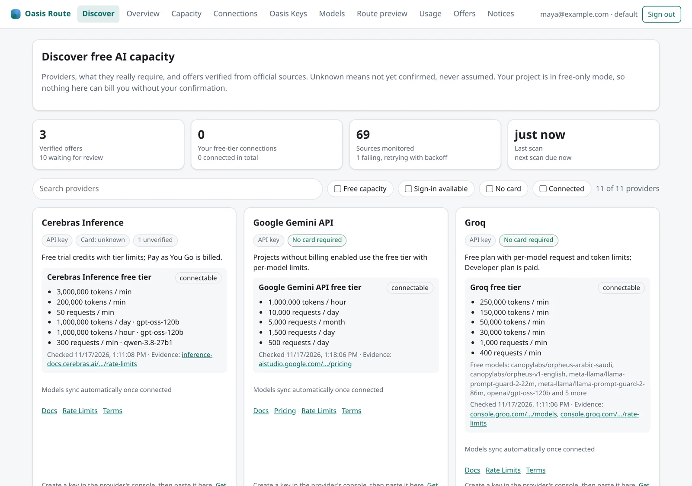

# OASIS Route

  

  
  
  
  

  <strong>One gateway. One Oasis Key. The strongest eligible route.</strong>
   
  Open-source inference discovery, provider intelligence, quota-aware routing, and policy-aware failover.

  <a href="#quickstart">Quickstart</a> ·
  <a href="#discover-free-capacity">Discover</a> ·
  <a href="#how-it-works">How it works</a> ·
  <a href="#capabilities">Capabilities</a> ·
  <a href="#api-compatibility">API compatibility</a> ·
  <a href="#documentation">Documentation</a> ·
  <a href="#security-and-trust">Security</a>

---

## What is OASIS Route?

**OASIS Route is an independent inference routing layer.** It discovers publicly documented inference offers, verifies their eligibility and terms, connects upstream accounts only with the account owner's authorization, and routes requests to the strongest suitable model with available capacity.

Connect it to **Oasis or any application that can call an OpenAI-compatible API**. Keep one gateway endpoint in your application while OASIS Route handles provider selection, quota reservations, health, and bounded failover behind it.

It is designed around one important distinction:

> **Finding an offer is not the same as having permission to use it.** Discovery, verification, authorization, and usable capacity are separate states.

## The idea

| Instead of… | OASIS Route… |
|---|---|
| Hard-coding one provider into every application | Gives applications one unified gateway |
| Choosing a model only by provider name | Selects by task fit, capability, eligibility, and available quota |
| Retrying blindly after a rate limit | Uses quota reservations, cooldowns, health state, and bounded failover |
| Treating public announcements as usable capacity | Preserves evidence and requires verification plus user authorization |
| Hiding a fallback or quality downgrade | Makes routing decisions explainable and signals downgrades honestly |

## Discover free capacity

<picture>
  <source media="(prefers-color-scheme: dark)" srcset="./assets/console-discover-dark.webp" />
  
</picture>

The console opens on **Discover**: every provider, what it really takes to get access, and the offers OASIS Route has found on official pages. The screenshot is a real run against the live seed sources on 2026-11-17.

- **Live sources.** Seventeen maintainer-reviewed official pages and public catalogues are checked on a schedule, plus related pages on the same official domains. robots.txt is honoured on every fetch.
- **Real requirements.** Access path (sign-in, API key or none), whether a card is needed (and whether that comes from evidence or documentation), per-model limits, free models, credits, trial length and expiry. Anything not confirmed is shown as unknown.
- **Verified before shown.** Extracted offers wait for a reviewer, who must cite the evidence. Users only see reviewed offers.
- **One click to connect.** Sign in with OpenRouter or Hugging Face through their official OAuth, or paste a key from the provider's console. Models and quotas then sync on their own.
- **Free-only by default.** New projects never route to a connection whose cost is paid or unknown. Allowing paid routes needs an explicit, audited acknowledgement.

## How it works

The discovery control plane and inference data plane are deliberately separate. Public-source discovery can populate the offer registry, but it cannot grant access to a provider or activate an offer on its own.

~~~mermaid
flowchart TB
  subgraph control["DISCOVERY CONTROL PLANE"]
    S["Public documentation and sources"] --> D["Discovery and extraction"]
    D --> E["Evidence and human verification"]
    E --> R["Offer registry"]
  end

  subgraph access["USER-AUTHORIZED ACCESS"]
    U["Your provider accounts"] --> V["Encrypted credential vault"]
  end

  subgraph inference["INFERENCE DATA PLANE"]
    C["Your application / SDK"] --> G["Unified API gateway"]
    G --> P["Task and policy analysis"]
    P --> Q["Capability and quota router"]
    Q --> A["Provider adapter layer"]
    A --> X["Upstream inference provider"]
    Q --> L["Usage ledger, health, and capacity"]
  end

  R --> Q
  V --> A

  classDef control fill:#182535,stroke:#6486a8,color:#e8f1fc
  classDef access fill:#16312e,stroke:#36b99f,color:#e6fff8
  classDef inference fill:#211d37,stroke:#9b83db,color:#f2edff
  class S,D,E,R control
  class U,V access
  class C,G,P,Q,A,X,L inference
~~~

### The request lifecycle

1. **Discover** — monitor permitted public sources, official provider documentation, repositories, announcements, and model catalogues.
2. **Verify** — preserve source evidence, evaluate eligibility and terms, and distinguish advertised capacity from verified capacity.
3. **Authorize** — connect a provider account or add an API credential that the account owner is entitled to use.
4. **Route** — rank eligible models by capability and task fit, reserve quota atomically, and dispatch to a suitable endpoint.
5. **Recover** — respond to rate limits, outages, expired credentials, and exhausted allocations using bounded, policy-aware failover.
6. **Measure** — reconcile usage, quota windows, shared pools, health, concurrency, and usable capacity.

## The Oasis Key

**Oasis Key** is the unified gateway credential issued by OASIS Route.

Your application authenticates to the OASIS Route gateway with its Oasis Key. OASIS Route then selects from the user's separately authorized upstream provider connections. Your application does not need a different gateway key for every inference provider.

Set the key in your environment:

~~~bash
export OASIS_API_KEY="your-oasis-key"
~~~

Send it as a bearer token:

~~~http
Authorization: Bearer <OASIS_API_KEY>
~~~

An Oasis Key is **not** an upstream provider credential. Provider API keys and OAuth tokens remain separately authorized and protected in the credential vault. Gateway keys are designed to be scoped, revealed only once at creation, revocable, and rotatable.

## Capabilities

| Capability | What it does |
|---|---|
| **Evidence-backed discovery** | Finds publicly documented offers and records provenance, timestamps, eligibility, terms, and review state |
| **Provider intelligence** | Separates advertised, verified, authorized, usable, consumed, and forecast capacity |
| **Quality-first routing** | Chooses the strongest suitable eligible model for the requested task, not merely the first provider in a list |
| **Atomic quota ledger** | Reserves capacity safely, accounts for shared quota pools, and settles actual usage |
| **Honest failover** | Uses circuit breakers, cooldowns, and bounded fallback without concealing a model downgrade |
| **Explainable decisions** | Provides route previews, routing reasons, and model/fallback metadata |
| **Background autonomy** | Supervises discovery, synchronization, health, recovery, and maintenance jobs with leases and crash recovery |
| **Operational visibility** | Tracks usage, capacity, health, forecasts, and plain-language system status |
| **Free-only spend policy** | Classifies every route as local, free model, free-tier account, paid or unknown, and blocks the last two unless the owner allows paid usage |
| **Official sign-in** | OpenRouter (PKCE key exchange) and Hugging Face (OAuth 2.0 + PKCE, refreshed in the background); API keys for everything else |

## API compatibility

Use the interface that matches your client. OASIS Route exposes these inference surfaces:

| API surface | Endpoints | Notes |
|---|---|---|
| **OpenAI Chat Completions** | <code>POST /v1/chat/completions</code>, <code>GET /v1/models</code> | OpenAI-compatible requests, streaming, and idempotency |
| **OpenAI Responses** | <code>POST /v1/responses</code> | Streaming and function calls; currently stateless |
| **Anthropic Messages** | <code>POST /v1/messages</code> | Messages API, streaming, and tool use |

The gateway supports <code>auto</code> and <code>auto/&lt;task&gt;</code> model aliases. Heuristic priors order unrated models strongest-first until better evidence is available.

### Provider adapters

Implemented adapters include:

- OpenAI
- Anthropic
- Gemini through its OpenAI-compatible endpoint
- Groq
- Mistral
- OpenRouter
- Cerebras
- NVIDIA API Catalog
- SambaNova
- Hugging Face router
- Custom OpenAI-compatible endpoints, including llama.cpp, Ollama, and vLLM

Official sign-in is available for OpenRouter (PKCE, redirect and headless modes) and Hugging Face (OAuth 2.0 + PKCE; needs an https `public_url` or a registered app). Other providers use API keys supplied by the account owner. Connected OpenRouter and Hugging Face accounts report whether they are free tier, so free-only routing can use them without manual confirmation.

## Quickstart

### 1. Run locally — no upstream account required

The fastest way to explore OASIS Route is its deterministic mock-provider mode. It starts the application without making upstream inference calls.

Requires [uv](https://docs.astral.sh/uv/).

~~~bash
uvx --from git+https://github.com/FAHTHIZ/OASIS-ROUTE oasis-route dev
~~~

The command prints the console URL, your project ID, and an Oasis Key.

### 2. Run with Docker

No local Python installation is needed:

~~~bash
docker run --rm -p 8080:8080 ghcr.io/fahthiz/oasis-route:edge dev
~~~

### 3. Install the command

~~~bash
uv tool install git+https://github.com/FAHTHIZ/OASIS-ROUTE
# Or: pipx install git+https://github.com/FAHTHIZ/OASIS-ROUTE

oasis-route dev --port 8080
~~~

### 4. Develop from a clone

~~~bash
git clone https://github.com/FAHTHIZ/OASIS-ROUTE.git
cd OASIS-ROUTE
uv sync
uv run oasis-route dev
~~~

### 5. Connect a provider and make a request

Open <code>/console/</code> and sign in with the Oasis Key. On **Connections → Paste your keys**, paste every provider key you hold (or your whole `.env`), tick the ownership box and press **Connect all**. Each key's provider is recognised automatically, the key is checked only with that provider, its models (and which of them are free) are synchronised, and routing starts using them immediately. **Discover** lists every provider with verified free capacity and links straight to where each one issues its free key; OpenRouter and Hugging Face can also be connected with **Sign in with ...** instead of a key.

The same step from a terminal, reading `GROQ_API_KEY`, `GEMINI_API_KEY`, `OPENROUTER_API_KEY`, `NVIDIA_API_KEY`, `HF_TOKEN` and the others from your environment or a `.env` file:

~~~bash
oasis-route connect --from-env                 # preview: shows what was recognised, stores nothing
oasis-route connect --from-env --env-file .env --accept-terms --free-tier
~~~

Then call the gateway:

~~~bash
curl https://route.example.com/v1/chat/completions \
  -H "Authorization: Bearer $OASIS_API_KEY" \
  -H "content-type: application/json" \
  -d '{
    "model": "auto",
    "messages": [
      {"role": "user", "content": "Explain the difference between a process and a thread."}
    ]
  }'
~~~

`model: "auto"` picks the strongest eligible model across all your connections (free first) and moves to the next strongest when one runs out of quota or fails. Claude Code and other Anthropic clients work through the Anthropic Messages endpoint:

~~~bash
export ANTHROPIC_BASE_URL=https://route.example.com
export ANTHROPIC_AUTH_TOKEN=$OASIS_API_KEY
claude
~~~

Any OpenAI SDK can use the same gateway by setting its base URL to <code>https://route.example.com/v1</code> and its API key to the Oasis Key.

### Production deployment

For a PostgreSQL-backed deployment, follow the [deployment guide](docs/DEPLOYMENT.md):

~~~bash
# Create .env with:
# POSTGRES_PASSWORD
# OASIS_ROUTE_MASTER_KEY
# OASIS_ROUTE_API_KEY_PEPPER

docker compose up -d --build
docker compose run --rm api bootstrap --email you@example.com
~~~

## Implementation status

OASIS Route is working software. The implementation roadmap is tracked phase by phase in the [execution plan](docs/EXECUTION_PLAN.md), and the [implementation audit](docs/IMPLEMENTATION_AUDIT.md) records the verification evidence. The test suite runs against SQLite and PostgreSQL in CI.

| Area | Implemented functionality |
|---|---|
| **Gateway** | OpenAI Chat Completions, OpenAI Responses, Anthropic Messages, streaming, cancellation, timeouts, and normalized errors |
| **Identity and security** | Project isolation, scoped Oasis Keys, encrypted credential vault, envelope encryption, KEK rotation, audit trails, and redaction |
| **Routing and quotas** | Capability-aware quality-first routing, route preview, atomic reservations, idempotency, shared quota pools, and usage settlement |
| **Recovery** | Circuit breakers, cooldowns, Retry-After handling, reset-aware recovery, and honest downgrade signalling |
| **Discovery** | Seed sources, bounded frontier, catalogue and rate-limit-table extraction, provider candidates, safe fetcher, evidence provenance, review workflow, and the Discover catalogue |
| **Onboarding and spend** | One-step paste-all-keys connect (console and `oasis-route connect`) with local provider detection, OpenRouter and Hugging Face sign-in, token refresh, account free-tier detection, per-connection billing modes, and the free-only spend policy |
| **Capacity and telemetry** | Capacity analytics and forecasting, usage ledger, health metrics, Prometheus metrics, and OpenTelemetry instrumentation |
| **Worker** | Database-leased jobs, backoff, timeouts, crash recovery, and stall alerts |
| **Console and deployment** | Web console, onboarding, Docker deployment, backup/restore guidance, and production runbooks |
| **Data rights** | Secret-free account export and account erasure that destroys stored credentials |
| **Mail notices** | Forwarded-mail support; Gmail integration is implemented but disabled by default behind its compliance gate |

## Known limitations

OASIS Route is deliberately explicit about what it does not serve or guarantee today:

- **Inference endpoints:** Chat Completions, Responses, Anthropic Messages, and Models are supported. Embeddings, images, audio, and legacy completions are not served.
- **Responses state:** the Responses API is currently stateless; <code>previous_response_id</code> is not supported.
- **Mid-stream recovery:** failover is possible only before the first response byte. A stream that fails midway ends with an error event rather than being spliced into another model's output.
- **Sign-in coverage:** OpenRouter and Hugging Face only. Hugging Face sign-in needs an https `public_url` (for its Client ID Metadata Document) or `OASIS_ROUTE_HF_OAUTH_CLIENT_ID`. Other providers use API keys, which can all be pasted at once.
- **Billing detection:** only OpenRouter and Hugging Face expose whether an account can be billed. For other providers a connection stays `unknown` (blocked in free-only projects) until the owner confirms it is free tier.
- **Accounts and keys are yours to create:** Oasis Route never signs up for provider accounts, solves sign-up checks or collects keys published elsewhere. Providers' terms tie free tiers to a person's own account (usually with email or phone verification), and leaked keys belong to someone else. You create each free account once; everything after pasting the key is automatic. This is the same model OmniRoute and FreeLLMAPI use.
- **Discovery reach:** official pages, catalogues and Atom/RSS announcement or release feeds that an operator has approved. No general web search. Discovered offers are proposed for review and are not routed until approved.
- **GitHub Models:** retired by GitHub on 30 July 2026 and not supported.
- **Provider data policies:** training and retention facts remain unknown for seeded providers until an operator records them with evidence. Providers are excluded from projects that require no-training or zero-retention when those facts are unknown. NVIDIA is seeded as training on inputs because its own pages state that inputs are used to improve its models.
- **Discovery activation:** extraction is deterministic (structured catalogues, HTML tables and patterns). It proposes offers for human review; it never activates an offer by itself.
- **Gmail:** off by default and must remain off in production until Google's verification and security assessment are complete.
- **Metrics exposure:** <code>/metrics</code> is unauthenticated and must remain on a private network.

## Security and trust

OASIS Route is built around authorized provider access—not credential harvesting or quota workarounds.

- It does not create provider identities or rotate accounts to reset free allocations.
- It does not harvest credentials or bypass provider access controls.
- It does not evade quotas or treat a public offer as permission to use it.
- Upstream credentials are separately authorized and encrypted in the credential vault.
- Discovery candidates require evidence, review, eligibility checks, and an authorized connection before they can become usable.
- Routing decisions and fallback behavior are designed to remain observable and explainable.

Read the [security and compliance model](docs/SECURITY_AND_COMPLIANCE.md), [threat model](docs/THREAT_MODEL.md), and [security policy](SECURITY.md).

## Documentation

| Need | Start here |
|---|---|
| **Use the API** | [API guide](docs/API.md) · [SDKs and coding tools](docs/INTEGRATIONS.md) |
| **Connect local models** | [Local models: llama.cpp, Ollama, vLLM](docs/LOCAL_MODELS.md) |
| **Understand routing** | [Routing and quotas](docs/ROUTING_AND_QUOTAS.md) · [Provider adapters](docs/PROVIDER_ADAPTERS.md) |
| **Understand discovery** | [Discovery and registry](docs/DISCOVERY_AND_REGISTRY.md) · [Live provider discovery and onboarding](docs/LIVE_PROVIDER_DISCOVERY_AND_ONBOARDING.md) · [Agent implementation prompt](docs/LIVE_PROVIDER_DISCOVERY_AGENT_PROMPT.md) · [Free-tier capacity maths](docs/FREE_TIER_CAPACITY.md) |
| **Configure the service** | [Configuration](docs/CONFIGURATION.md) · [Deployment](docs/DEPLOYMENT.md) |
| **Operate it** | [Operations runbook](docs/OPERATIONS.md) · [Zero-operations autonomy](docs/ZERO_OPERATIONS_AUTONOMY.md) |
| **Explore the design** | [Architecture](docs/ARCHITECTURE.md) · [Decision records](docs/adr/): [stack](docs/adr/0001-stack-and-architecture.md), [free-only spend](docs/adr/0002-free-only-spend-policy.md), [seed sources and frontier](docs/adr/0003-seed-sources-and-frontier.md) |
| **Review the project** | [Implementation audit](docs/IMPLEMENTATION_AUDIT.md) · [Release checklist](docs/RELEASE_CHECKLIST.md) |
| **Compare alternatives** | [Comparison with LiteLLM, OmniRoute, and others](docs/COMPARISON.md) |
| **Contribute** | [Development guide](docs/DEVELOPMENT.md) · [Agent handoff](AGENT_HANDOFF.md) |

## Design principles

1. **Evidence before assumptions.** Every offer has provenance, timestamps, status, and a review trail.
2. **Authorization before dispatch.** Discovering a provider offer never grants access to it.
3. **Quality before convenience.** Choose the strongest suitable model that is eligible and has capacity.
4. **Quota correctness before throughput.** Reserve capacity atomically before dispatch.
5. **Honest recovery.** Never hide a downgrade or silently violate task requirements.
6. **Provider-neutral core.** Provider-specific behavior belongs in adapters, not routing business logic.
7. **Explainable by default.** Route decisions, quota reservations, and fallbacks should be inspectable.
8. **Independent by design.** OASIS Route can be used without Oasis.
9. **Zero routine operations.** After an authorized connection is added, onboarding, discovery, quota synchronization, routing, health checks, and recovery should run automatically in the background.

## Contributing

Contributions are welcome. Start with [CONTRIBUTING.md](CONTRIBUTING.md) and [docs/DEVELOPMENT.md](docs/DEVELOPMENT.md) for the setup instructions and quality gates.

Provider-specific behavior belongs in adapters. Do not wrap competing gateways or duplicate their routing engines.

## License

OASIS Route is licensed under the [Apache License 2.0](LICENSE).
