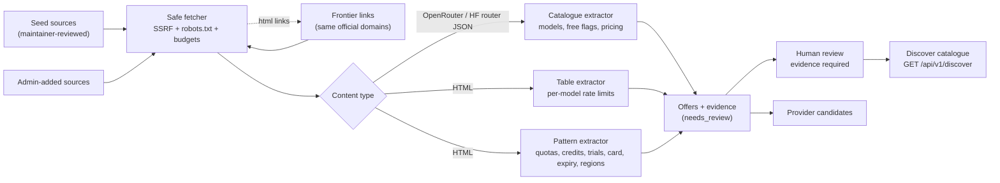

# Discovery and Offer Registry

## 1. Goal

Continuously discover legitimate public inference offers and changes to existing offers. No crawler can guarantee coverage of the entire internet; use targeted source discovery, incremental crawling, search/index integrations where permitted, and community-reviewed submissions.

## 1.1 What runs today

Everything below is implemented and covered by tests (`tests/test_live_discovery.py`, `tests/test_discovery_review.py`, `tests/test_discover_view.py`). It was last exercised against the live seed sources on 2026-11-17: 16 of 17 seeds were fetched. The Gemini rate-limits page had moved to another host (`ai.google.dev` now redirects to `aistudio.google.com`); the fetcher refuses cross-host redirects by design, so the seed was updated and moved seeds are migrated automatically (`seeds.MOVED`).

| Piece | Where | What it does |
|---|---|---|
| Seed sources | `discovery/seeds.py` | 17 official pages and catalogues (OpenRouter, Hugging Face, Groq, Gemini, Cerebras, SambaNova, Mistral, NVIDIA, OpenAI, Anthropic). Inserted only if missing, so an admin's block or edit sticks. `OASIS_ROUTE_DISCOVERY_SEED_SOURCES=false` turns them off. |
| Safe fetcher | `discovery/fetcher.py` | https only, SSRF check on every hop, redirects limited to the source's host, robots.txt before every fetch (unreachable robots means disallow), per-origin interval and `Crawl-delay`, conditional requests, size cap, content-type allow-list. |
| Structured extractors | `discovery/structured.py` | OpenRouter `/api/v1/models` (free models, `:free` variants, pricing, context, tool support) and the Hugging Face router catalogue (models and the inference providers behind them). HTML tables are parsed into per-model request and token limits, tagged with the tier named by the nearest heading. |
| Pattern extractor | `discovery/extraction.py` | Quotas, credits (`$5 in trial credits`), trial lengths, "no card required", expiry dates (price schedules such as "$2.00 through November 30" are ignored), age and region restrictions, evaluation-only wording. Page text is data: instructions inside it cannot change offer state. |
| Offer grouping | `discovery/service.py` | Claims become one offer per provider and access mode: `free_tier`, `credits`, `rate_limits` (published limits of a provider documented as billed, class `paid`), or `unspecified`. Each source owns its own quota rows, so two pages never erase each other. |
| Frontier | `discovery/urls.py`, `service.py` | Links from an official HTML page are followed when they stay on the provider's official domains, mention pricing, limits, free tiers, models, terms or changelogs, and are not account, settings, login, upgrade, privacy or cookie pages. Depth 1 and 25 pages per provider by default. |
| Provider candidates | `ProviderCandidate` | Inference providers seen in a catalogue (for example behind the Hugging Face router) that are not in the registry yet. Admins accept or dismiss them at `/api/v1/admin/provider-candidates`. |
| Review | `discovery/review.py` | `needs_review -> verified_eligible -> connectable -> active`. Verification must cite evidence records. Material changes on a later fetch move an offer back to review. |
| Discover catalogue | `discovery/view.py` | Read model behind the console's Discover tab. Users see only reviewed offers; unreviewed ones are counted. |
| Scheduling | `worker/runner.py` | `discovery.seed_sources` keeps seeds present; `discovery.sources` fetches what is due, with exponential backoff per source. `POST /api/v1/admin/discovery/run` runs due sources now. |

Not implemented: general web search (no search API is configured and none is used), GitHub release and announcement feeds, and re-extraction of unchanged pages after an extractor upgrade (a page is re-read only when its content changes).

## 2. Source classes

Prioritize:
1. Official provider API documentation and pricing/quota pages.
2. Official developer announcements and changelogs.
3. Official provider GitHub organizations and SDK repositories.
4. Public model catalogues and inference platform documentation.
5. Public, reputable curated directories, treated as leads rather than authoritative evidence.
6. User-submitted URLs and evidence, clearly marked as unverified until reviewed.

Do not crawl private account pages, authenticated dashboards, leaked dumps, secret repositories, or unrelated personal data.

## 3. Source policy

Every source connector must declare:
- canonical domain and URL scope;
- allowed request methods;
- terms/robots review status;
- request rate and concurrency budget;
- crawl interval and retention;
- user-agent/contact identification where appropriate;
- conditional request support (ETag/Last-Modified);
- error and backoff policy.

Respect applicable site terms, robots directives, rate limits, access controls, and privacy law. Do not circumvent CAPTCHAs, logins, paywalls, blocks, or technical restrictions.

## 4. Offer lifecycle

`DISCOVERED -> NEEDS_REVIEW -> VERIFIED_ELIGIBLE -> CONNECTABLE -> ACTIVE`

Alternative terminal/intermediate states:
`REJECTED`, `INELIGIBLE`, `EXPIRED`, `SUSPENDED`, `STALE`, `REVOKED`.

A discovered page is not proof that a user qualifies. A verified offer is not an authorized connection. An authorized connection is not proof that quota remains.

## 5. Evidence record

Store:
- source URL and publisher;
- retrieval timestamp and HTTP metadata;
- relevant text excerpt or permitted snapshot;
- hash of captured evidence;
- claim being supported (quota, price, age/audience, region, model, expiry, use restrictions);
- reviewer/verification method;
- confidence and next review date.

Avoid retaining full pages where excerpts and hashes suffice. Honour source licences and retention requirements.

## 6. Suggested domain model

- Provider: identity, official domains, policy URL, status.
- Model: provider model ID, aliases, capabilities, context limits, lifecycle.
- Offer: access mode, quota claims, price/credit type, eligibility, expiry, terms, evidence references.
- Source: source connector, scope, crawl policy, last successful check.
- QuotaPool: shared accounting scope and limits.
- Connection: user-owned provider account reference and authorization state.
- Endpoint: base URL, protocol, region, health state, adapter key.
- Verification: evidence, reviewer, decision, rationale, timestamp.
- ChangeEvent: old/new values, source, severity, action required.

## 7. Deduplication

Deduplicate offers using provider identity, account/project scope, model family, quota scope, and reset period. If multiple credentials share one upstream project budget, they must not multiply aggregate capacity.

## 8. Change detection

On changed source content:
- diff normalized relevant sections;
- re-extract claims;
- mark material changes for review;
- suspend affected offer if eligibility or terms become unclear;
- notify connected users when an action is required.

## 9. Capacity estimates

Only count a pool in current usable capacity when the user's connection is valid, policy eligibility is confirmed, the endpoint is healthy, quota is available, and the offer has not expired. Show source and confidence alongside totals.
