# Free-tier token capacity: the maths

How many tokens per month can one person route through OASIS Route using only free tiers, legitimately? This page gives a reproducible answer from **published** limits. Regenerate the tables with:

```bash
python scripts/free_tier_capacity.py
```

Limits were last checked on **2026-11-23**. Providers change free tiers often. OASIS Route does not rely on these numbers at runtime: it learns real limits from response headers and `429`s, and reports them through `GET /api/v1/projects/{id}/capacity`.

## The short answer

<picture>
  <source media="(prefers-color-scheme: dark)" srcset="../assets/readme/capacity-dark.svg" />
  
</picture>

| You have… | Chat traffic (1,500 tokens a request) | Coding-agent traffic (20,000 tokens a request) |
|---|---|---|
| Free accounts only, nothing bought | **about 24-32 million tokens a month** | **about 63-71 million tokens a month** |
| Plus a one-time 10-credit OpenRouter top-up | about 75 million | **about 650 million** |
| Plus NVIDIA's prototyping API at full use | about 2.7 billion (ceiling) | about 36 billion (ceiling) |

The honest headline is **about 30 million tokens a month for chat and about 70 million for agents, with no purchase at all**. The 650 million agent figure is real but needs a one-time OpenRouter credit purchase. The NVIDIA rows are a mathematical ceiling under trial terms that allow prototyping only, not a forecast.

## Rules for the count

1. **One account per provider.** Every provider's terms limit free tiers to one account per person. OASIS Route refuses multi-account pooling unless a provider explicitly permits it, so the count never multiplies by accounts.
2. **Published numbers only.** If a provider shows limits only inside its console, that tier counts as *unknown*, not zero and not a guess.
3. **Recurring only.** One-time trial credits are listed separately and add nothing per month.
4. **The binding limit wins.** For each quota pool:

```math
\text{tokens/day} = \min\left(\text{TPD},\ \text{RPD}\cdot S,\ \text{TPM}\cdot 1440,\ \text{RPM}\cdot 1440\cdot S,\ \tfrac{\text{RPMo}\cdot S}{30.44},\ \tfrac{N}{n(S)}\cdot S\right),
\qquad
\text{tokens/month} = \text{tokens/day}\cdot \tfrac{365.25}{12}
```

where `S` is tokens per request (input plus output), `RPMo` a monthly request cap and, for budget-metered tiers, `N` the daily unit budget and `n(S)` the units one request costs. If `S > TPM` the pool can never serve that request, so it contributes 0.

Two request profiles are shown: a **chat** turn (1,200 in + 300 out = 1,500 tokens) and a **coding-agent** turn (18,000 in + 2,000 out = 20,000 tokens). Agents such as Claude Code resend large contexts on every call.

## Per pool

| Pool | Binding limits | Tokens/month, chat (1,500 tok/request) | Tokens/month, coding agent (20,000 tok/request) |
|---|---|---|---|
| [Groq](https://console.groq.com/docs/rate-limits) openai/gpt-oss-120b | RPM 30, RPD 1.00K, TPM 8.00K, TPD 200.00K | 6.09M | 0 |
| [Groq](https://console.groq.com/docs/rate-limits) openai/gpt-oss-20b | RPM 30, RPD 1.00K, TPM 8.00K, TPD 200.00K | 6.09M | 0 |
| [Groq](https://console.groq.com/docs/rate-limits) qwen/qwen3.8-27b | RPM 30, RPD 1.00K, TPM 8.00K, TPD 200.00K | 6.09M | 0 |
| [SambaNova](https://docs.sambanova.ai/docs/en/models/rate-limits) gpt-oss-120b | RPM 20, RPD 20, TPD 200.00K | 913.12K | 6.09M |
| [SambaNova](https://docs.sambanova.ai/docs/en/models/rate-limits) gemma-4-31B-it | RPM 20, RPD 20, TPD 200.00K | 913.12K | 6.09M |
| [OpenRouter](https://openrouter.ai/docs/api/reference/limits) all `:free` models (shared) | RPM 20, RPD 50 | 2.28M | 30.44M |
| [Cohere](https://docs.cohere.com/docs/rate-limits) Command models, trial key (shared) | RPM 20, req/month 1.00K | 1.50M | 20.00M |
| [Cloudflare Workers AI](https://developers.cloudflare.com/workers-ai/platform/pricing/) `@cf/openai/gpt-oss-120b` (custom endpoint) | neurons/day 10.00K | 7.79M | 8.58M |
| [OpenRouter](https://openrouter.ai/docs/api/reference/limits) all `:free` models (shared) | RPM 20, RPD 1.00K | 45.66M | 608.75M |
| [NVIDIA build.nvidia.com](https://build.nvidia.com/search) most hosted models | RPM 40 | 2.63B | 35.06B |

Worked example (Groq `openai/gpt-oss-120b`, chat profile): `min(200,000, 1,000 × 1,500, 8,000 × 1,440, 30 × 1,440 × 1,500) = 200,000` tokens/day, times 30.44 = 6.09M tokens/month. For the agent profile a single 20,000-token request is larger than the 8,000-token-per-minute budget, so Groq's free tier cannot serve it at all.

Worked example (Cloudflare `@cf/openai/gpt-oss-120b`, chat profile): one request costs `1,200 × 31,818 / 10⁶ + 300 × 68,182 / 10⁶ ≈ 58.6` neurons, so 10,000 neurons buy about 171 requests, or 256K tokens a day and 7.8M a month. Smaller models stretch the same budget further: `@cf/zai-org/glm-4.7-flash` costs about 17.5 neurons per chat request, about 26M tokens a month.

## Totals

| Scenario | chat (1,500 tok/request) | coding agent (20,000 tok/request) |
|---|---|---|
| A. Published recurring floor (Groq + SambaNova + OpenRouter + Cohere, no purchase) | 23.87M | 62.61M |
| B. A + Cloudflare Workers AI through a custom endpoint | 31.66M | 71.20M |
| C. B + OpenRouter 10-credit unlock (one-time purchase) | 75.03M | 649.51M |
| D. C + NVIDIA prototyping ceiling (100% utilisation) | 2.70B | 35.71B |

How to read this:

- **Scenario A, about 24 million chat or 63 million agent tokens a month**, is the guaranteed floor from published, recurring, no-purchase limits, using providers OASIS Route ships adapters for. [Groq's Free Plan tab](https://console.groq.com/docs/rate-limits) gives 200,000 tokens a day on each of three chat models. [SambaNova's Free Tier](https://docs.sambanova.ai/docs/en/models/rate-limits) (page modified 2026-11-20) now lists only `gpt-oss-120b` and `gemma-4-31B-it`, down from three models on 2026-11-17. [Cohere](https://docs.cohere.com/docs/rate-limits) trial keys allow 1,000 calls a month at 20 a minute; they are evaluation keys, not production keys.
- **Scenario B** adds [Cloudflare Workers AI](https://developers.cloudflare.com/workers-ai/platform/pricing/), whose 10,000 free neurons a day are reachable through a custom OpenAI-compatible connection (`https://api.cloudflare.com/client/v4/accounts/<account_id>/ai/v1`).
- **Scenario C** adds a one-time purchase of 10 OpenRouter credits, which [raises the shared free-model cap](https://openrouter.ai/docs/api/reference/limits) from 50 to 1,000 requests a day. The credits are only spent if you call paid models. Request-capped pools favour large requests, so agent-style traffic reaches about 0.65 billion tokens a month.
- **Scenario D** adds [NVIDIA's](https://build.nvidia.com/search) published "up to 40 requests per minute" at 100% utilisation, around the clock. That is a ceiling, not a forecast. NVIDIA describes the API as free *to prototype with*, and its [trial terms](https://assets.ngc.nvidia.com/products/api-catalog/legal/NVIDIA%20API%20Trial%20Terms%20of%20Service.pdf) allow internal testing and evaluation only. Its model pages also say inputs and outputs are recorded to improve NVIDIA's models, so the built-in NVIDIA provider carries a `trains_on_inputs: true` data policy and is excluded from projects that require no-training.

### What changed since 2026-11-17

| Provider | 2026-11-17 | 2026-11-23 | Effect |
|---|---|---|---|
| SambaNova | 3 free production models | 2 free models (`gpt-oss-120b`, `gemma-4-31B-it`) | −0.9M chat, −6.1M agent |
| Cohere | not counted | 1,000 trial calls a month published | +1.5M chat, +20M agent |
| Cloudflare Workers AI | not counted | 10,000 neurons a day, via custom endpoint | +7.8M chat, +8.6M agent |
| Mistral | console-only limits | Free mode "doesn't include API access" | stays out of the count |
| Hugging Face | not counted | free users get no monthly credits | stays out of the count |

### Free tiers that exist but cannot be counted

They add capacity, but their size is not published or not recurring.

- [Google Gemini API](https://aistudio.google.com/docs/rate-limits): free tier per project; per-model limits are shown only in AI Studio.
- [Z.ai](https://docs.z.ai/guides/overview/pricing): GLM-4.7-Flash, GLM-4.5-Flash and GLM-4.6V-Flash are priced at $0, but no rate limits are published.
- [Cerebras](https://inference-docs.cerebras.ai/support/rate-limits): one-time $5 trial credit after adding a payment method, expiring after 30 days; no renewing free tier.
- [Mistral AI](https://docs.mistral.ai/admin/billing-usage/usage-limits): Free mode no longer includes API access; API keys need billing activation.
- [Hugging Face Inference Providers](https://huggingface.co/docs/inference-providers/pricing): free users get no monthly credits; PRO includes $2.00 a month.
- [GitHub Models](https://docs.github.com/en/github-models/use-github-models/prototyping-with-ai-models): retired on 2026-07-30.

Once you connect them, OASIS Route measures these tiers itself. Learned limits appear in the capacity report alongside the published ones. Z.ai's three free Flash models and a Gemini free-tier project are usually the largest of these in practice.

## Local models

A model on your own hardware has no quota, only a speed limit. Measured on 2026-11-17 with Qwen2.5-0.5B-Instruct Q4_K_M on llama.cpp (2 CPU cores, see [LOCAL_MODELS.md](LOCAL_MODELS.md)): about 27 ms per generated token, or 37 tokens/s. At 100% utilisation that is \(37 \times 86{,}400 \approx 3.2\)M output tokens a day, about 97M a month, from a tiny model on a laptop-class CPU. Larger models and GPUs change this by orders of magnitude in both directions, so measure your own hardware.

## Comparison with other gateways' claims

[OmniRoute's free-tier reference](https://github.com/cheaper-inference/OmniRoute/blob/main/docs/reference/FREE_TIERS.md) advertises about **1.62B tokens a month**, computed as daily caps × 30 or RPD × 800 output tokens × 30, deduplicated by pool. Its own breakdown shows where that total comes from:

| OmniRoute pool | Its monthly figure | Status on 2026-11-23 |
|---|---|---|
| Mistral | ~1.00B | Mistral's [usage-limits page](https://docs.mistral.ai/admin/billing-usage/usage-limits) now says Free mode doesn't include API access |
| nara, llm7, xkiro, api-airforce, bluesminds, bazaarlink | ~545M | Third-party aggregators and proxies; OASIS Route has no adapter for them and does not count intermediaries whose terms it cannot verify |
| Groq, Cloudflare, SambaNova, OpenRouter, Cohere, Hugging Face | ~68M | First-party pools, the same set this page counts |
| Others (arcee, huggingchat, morph, kiro) | ~6M | Small pools |

The first-party share, about **68M**, lines up with this page's 32M-71M no-purchase range; the gap comes from OmniRoute assuming 800 output tokens per request and counting five Groq models. The rest of its headline depends on a tier its provider has withdrawn from the API and on intermediaries whose terms and data handling OASIS Route cannot verify. The figures here are deliberately conservative: only published, recurring, one-account limits from first-party providers, with the binding constraint applied per request size.
